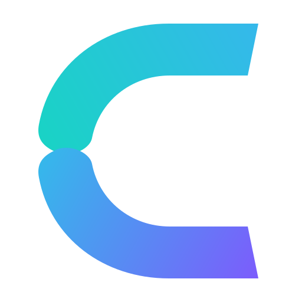

<div align="center">
  
  <h1>CLIVORA Web</h1>
  <p><strong>The official web application, client workspace, and remote jobs platform for CLIVORA, the open-source Freelancer OS.</strong></p>
  <p>Run client operations, track projects, issue milestone invoices, discover verified remote tech jobs, and connect directly with $0 platform deal fees.</p>

  [](https://clivora.io)
  [](https://play.google.com/store/apps/details?id=org.codcrafters.clivora)
  [](https://doi.org/10.5281/zenodo.22843765)
  [](https://clivora.io/download)
  [](https://clivora.io)
  [](https://github.com/UsmanGhias/clivora-web/stargazers)
  [](LICENSE)
  [](https://nextjs.org)
  [](https://www.typescriptlang.org)
  [](https://tailwindcss.com)
  [](https://supabase.com)

  <p>
    <a href="https://clivora.io">Official Website</a> &middot;
    <a href="https://clivora.io/app">Web Portal</a> &middot;
    <a href="https://play.google.com/store/apps/details?id=org.codcrafters.clivora">Google Play Store</a> &middot;
    <a href="https://clivora.io/download">Download Center</a> &middot;
    <a href="https://clivora.io/open-source">Open Source Hub</a> &middot;
    <a href="https://clivora.io/jobs">Remote Jobs (7,150+)</a> &middot;
    <a href="https://clivora.io/docs">Documentation</a> &middot;
    <a href="https://github.com/UsmanGhias/clivora">Mobile Repository (Flutter)</a>
  </p>
</div>

## Platform Traction and Community Metrics

| Metric | Verified Metric / Status | Source and Direct Links |
|---|---|---|
| **Package Downloads** | **100+** | [Google Play Store](https://play.google.com/store/apps/details?id=org.codcrafters.clivora) &amp; [Verified APK/AAB Builds](https://clivora.io/download) |
| **Community Views & Visitors** | **100+** | [Official Portal (clivora.io)](https://clivora.io) &amp; [Open Source Hub](https://clivora.io/open-source) |
| **GitHub Stars** | **★ 1+** (Growing) | [Star on GitHub](https://github.com/UsmanGhias/clivora-web/stargazers) |
| **Zenodo DOI Research Archive** | `10.5281/zenodo.22843765` | [Permanent Scientific Archive](https://doi.org/10.5281/zenodo.22843765) |
| **Deal Platform Fee** | **$0 (0% cut)** | Direct client-to-freelancer payments |
| **Indexed Tech Jobs** | **7,150+ listings** | [Remote Jobs Harvester](https://clivora.io/jobs) |

## Direct Platform Connections

Access live CLIVORA environments directly:

- **Official Web Portal**: [clivora.io](https://clivora.io)
- **Web Application**: [clivora.io/app](https://clivora.io/app)
- **Google Play Store Listing**: [CLIVORA on Google Play](https://play.google.com/store/apps/details?id=org.codcrafters.clivora)
- **Official Download Center**: [clivora.io/download](https://clivora.io/download)
- **Open Source Suite**: [clivora.io/open-source](https://clivora.io/open-source)
- **Remote Jobs Harvester**: [clivora.io/jobs](https://clivora.io/jobs)
- **Platform Documentation**: [clivora.io/docs](https://clivora.io/docs)
- **Mobile Client Repository**: [UsmanGhias/clivora](https://github.com/UsmanGhias/clivora)

## Core Capabilities

- **Dual-Desk Operating System**: Single unified login with specialized interfaces for freelancers (CRM, invoices, proposals, time tracking) and clients (project tracking, milestone approvals, talent search).
- **Remote Jobs Harvester**: Sub-second search across 7,150+ verified engineering, design, AI, and DevOps positions crawled from global engineering job clusters.
- **Private Connect Marketplace**: Post jobs and submit bids privately. Direct contact details remain protected until mutual proposal acceptance.
- **Milestone Invoicing & Escrow**: Multi-currency invoice generator with direct client payouts and $0 commission deduction.
- **Cross-Platform Sync Parity**: Shared PostgreSQL schema with Row Level Security (RLS) guaranteeing real-time parity between this Next.js web application and the Flutter mobile client.

## Architecture and Technology Stack

- **Framework**: Next.js 15 (App Router, React 19, Server Actions, Server Components)
- **Language**: TypeScript (Strict type checking across all data contracts)
- **Styling**: Tailwind CSS with responsive layout tokens and dark mode support
- **Database & Auth**: Supabase PostgreSQL with strict Row Level Security (RLS) policies
- **Mobile Client**: Flutter 3.x cross-platform app ([UsmanGhias/clivora](https://github.com/UsmanGhias/clivora))

## Quickstart

### Prerequisites

- Node.js 18.17+ or 20+
- npm or pnpm
- Supabase project credentials

### Local Setup

1. Clone the repository and install dependencies:
```bash
git clone https://github.com/UsmanGhias/clivora-web.git
cd clivora-web
npm install
```

2. Configure environment variables:
```bash
cp .env.example .env.local
```
Provide your Supabase URL and anonymous keys in `.env.local`.

3. Run the development server:
```bash
npm run dev
```

Open [http://localhost:3000](http://localhost:3000) to view the application.

4. Run type verification:
```bash
npm run typecheck
```

## Citation and Research

CLIVORA's synchronization engine and architectural models are archived on Zenodo:

```bibtex
@article{khan2026clivora,
  title={Durable Edge-Outbox Synchronization: Managing Relational Divergence in Intermittent Mobile Enterprise Workloads},
  author={Khan, Muhammad Usman},
  journal={Zenodo},
  year={2026},
  month={9},
  doi={10.5281/zenodo.22843765},
  url={https://doi.org/10.5281/zenodo.22843765}
}
```

For academic and engineering citations, refer to [Zenodo Record 22843765](https://doi.org/10.5281/zenodo.22843765).

## Security

Please report vulnerabilities directly to **contact@clivora.io** per our [Security Policy](SECURITY.md). Never open public GitHub issues for security disclosures.

## License

Released under the **GNU Affero General Public License v3.0 (AGPL-3.0)**. See [LICENSE](LICENSE) for details.

Curated and architected by [Usman Ghias](https://usmanghias.co.uk).
